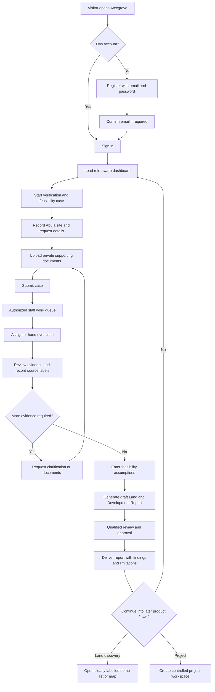
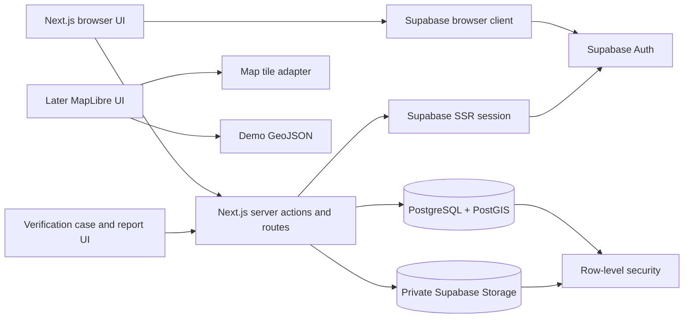

# Atexgrove - Prototype Flow and Delivery Map

## Payment Decision

No payment service is required for the current prototype.

The prototype does not collect money, sell subscriptions, process land purchases, charge professionals, or manage construction payments. Land prices, feasibility revenue, and cost figures are demo estimates only.

Do not add Stripe, Paystack, Flutterwave, or another payment provider yet. Reserve a `PaymentProvider` adapter for a later phase so a real provider can be added without changing project, land, or accounting domains.

## Primary User Flow

This is the accepted controlled-pilot delivery direction. It is not a claim that the case or report workflow is already implemented.

## System Boundary Flow

## Responsibility map

| Journey stage | Boundary that matters |
| --- | --- |
| Login/onboarding | Supabase Auth establishes identity and session; profile/role data is not a complete permission grant. |
| Discover land | Server/API validation, ownership/scope checks and bounded pagination; GIS is visual/platform data unless authority is explicit. |
| View parcel/details | PostGIS/GeoJSON query plus source, jurisdiction, data-as-of and DEMO/NOT OFFICIAL labels. |
| Verification | Structured type/status/evidence/reviewer/source; authority hierarchy remains visible and auditable. |
| Documents | Private storage, metadata/version checks and authorization before preview/download; no guessable public URL. |
| Project/professionals | Organization/project membership and project role checks; professional discipline is not a permission. |
| Feasibility | Deterministic inputs/rules/outputs, reproducible scenarios and clear estimate/uncertainty labels. |
| Admin/review | Separated responsibilities, least privilege, scope and audit logging for sensitive actions. |

Every vertical slice must pass through the relevant server/business, database/RLS, storage and test boundaries. A screen alone is not a completed feature.

## Delivery Phases

### Phase 0 - Design lock

**Output:** approved requirements, wireframes, design tokens, domain ownership rules, and test cases.

**Exit gate:** every must-work feature has an acceptance signal and a named test layer.

### Phase 1 - Foundation

**Output:** repository, environment, Supabase project, migrations, RLS, sessions, registration, login, role selection, and dashboard shell.

**Status:** foundation migrations and the first auth flow are working and manually verified.

**Implemented and merged:** password recovery/callback code, profile onboarding details, private-storage migration, security guardrails, synthetic fixture tooling, migrations `015`-`017`, pgTAP files, and a database-test GitHub Actions workflow.

**Hosted evidence (2026-10-14):** migrations `001`-`017` are recorded remotely; the `documents` bucket is private; foundation table RLS and storage policies are present.

**Still unverified/open:** pgTAP behavior on a fresh stack, final database-test CI evidence, hosted Auth redirect/email behavior, end-to-end recovery and unresolved security/performance advisor findings. Docker is only needed for local Supabase testing; GitHub Actions can provide that environment.

### Phase 2 - Verification case and private evidence

**Output:** customer request, internal work queue, assignment/handover, status history, reviewer notes, private evidence, and audit events.

**Exit gate:** a customer can submit a case and authorized staff can process it without public documents, cross-case access, silent reassignment, or fake verification claims.

### Phase 3 - Feasibility and Land & Development Report

**Output:** deterministic assumptions/calculations, source and authority labels, reviewed report generation, delivery, and explicit limitations.

**Exit gate:** the report is reproducible, reviewable, access-controlled, and honest about estimates, sources, authority, and unresolved matters.

### Phase 4 - Controlled land discovery and GIS

**Output:** synthetic Abuja parcel data, search/filter, list/map toggle, site/parcel detail, PostGIS/GeoJSON integration, and provenance labels.

**Exit gate:** a signed-in user can discover clearly labelled demo parcels without the map implying cadastral or legal authority.

### Phase 5 - Projects, professionals, and scoped admin

**Output:** project workspace, membership rules, professional directory/involvement, project documents, scoped administration, and audit review.

**Exit gate:** a completed case or parcel can move into a permission-checked project workspace, and each administrator can perform only their granted scope.

### Phase 6 - Integration and release confidence

**Output:** replace reserved tests with real unit/integration/E2E coverage, execute migrations and pgTAP in Docker-capable CI, complete responsive/accessibility and error-state review, and produce a deployable preview.

**Exit gate:** `npm test`, typecheck, lint, build, and the complete Playwright journey pass without fake success states.

Payments, subscriptions and entitlement checks are not part of the current prototype. Do not add checkout, payment credentials or financial state to this journey.

## Execution Rule

Work in vertical slices. For each phase:

1. Define the data and permission contract.
2. Write the unit and integration tests.
3. Implement the server and database boundary.
4. Implement the UI states.
5. Add the E2E path.
6. Run the phase exit gate before starting the next phase.

Do not build disconnected screens ahead of the data boundary they depend on.

## Future extension points

The completed prototype leaves explicit, non-implemented extension points for planning, approvals, construction, property management, finance/payments, AI-assisted analysis, mobile GPS/photo/document capture with future offline synchronization, and urban intelligence. These extensions must reuse the backend authorization, provenance, audit and provider-adapter boundaries rather than bypassing them.
